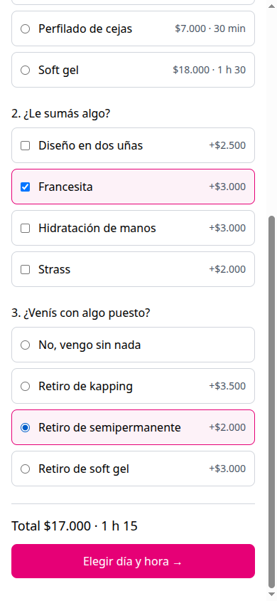
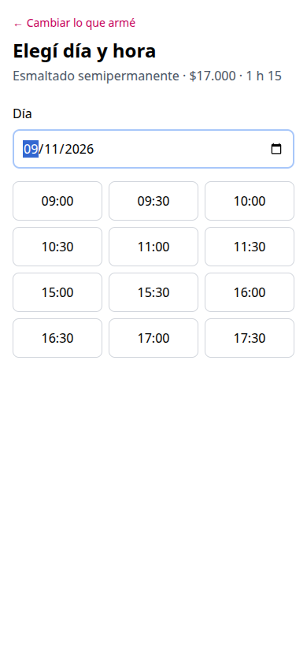
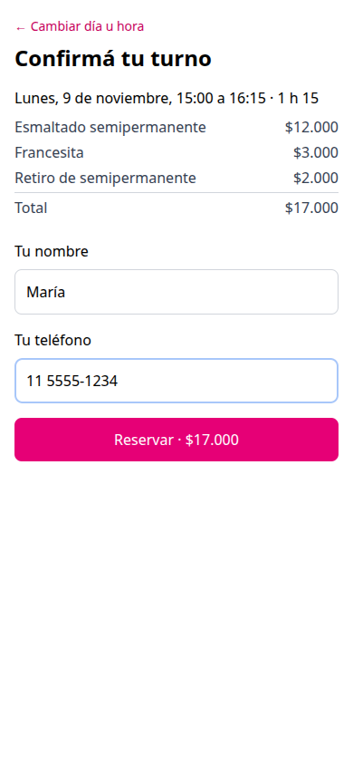
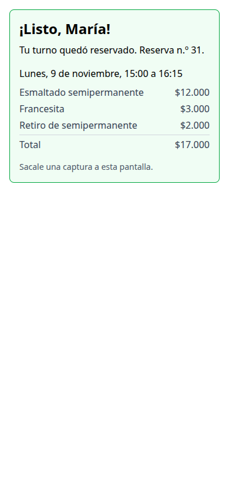
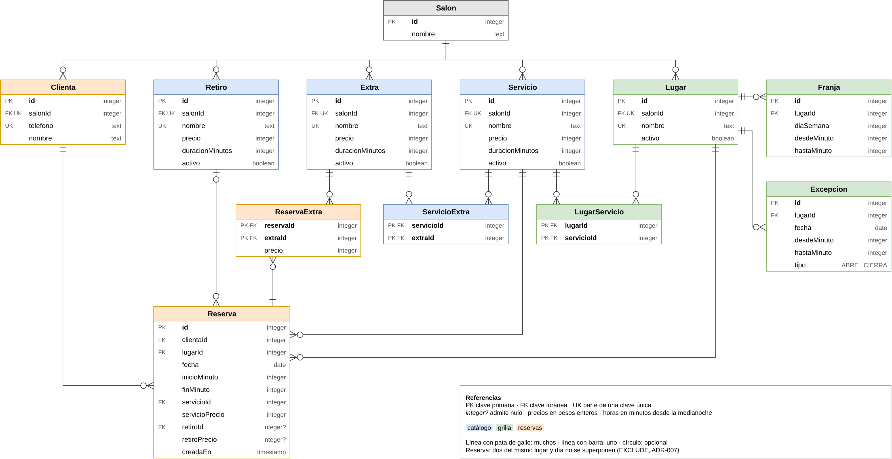

::: {custom-style="Title"}
&nbsp;
:::

| | |
|---|---|
| **Universidad** | Universidad Tecnológica Nacional |
| **Carrera** | Tecnicatura Universitaria en Programación |
| **Materia** | Proyecto Final |
| **Proyecto** | Sistema de turnos para un salón de estética |
| **Grupo** | 116 |
| **Integrantes** | Gustavo Tiseira · Nicolás Viruel |
| **Tutor** | Santiago Fonzo |
| **Año** | 2026 |
| **Repositorio** | <https://github.com/brujoh88/tfi-grupo116> |
| **Sistema online** | <https://tfi-grupo116.vercel.app> (panel del salón: `/panel`) |
| **API online** | <https://tfi-grupo116-production.up.railway.app/docs> |
| **Video** | PENDIENTE — enlace al video |

```{=openxml}
<w:p><w:r><w:br w:type="page"/></w:r></w:p>
```

# 1. El problema

El caso es un salón de estética real, que se presenta anonimizado. Atiende hasta
unas 25 personas por día entre cejas, pestañas y manicuría, y **da sus turnos a
mano, por mensaje**: la clienta escribe por Instagram o por WhatsApp, alguien del
salón le contesta qué horarios quedan, y el turno se anota. La disponibilidad se
publica como una imagen que hay que rehacer cada vez que algo cambia; como la
imagen envejece apenas se toma un turno, la clienta igual pregunta y el circuito
vuelve a empezar.

El problema afecta a tres actores:

| Actor | Qué hace hoy | Qué necesita |
|---|---|---|
| La dueña | Contesta los mensajes, arma la agenda, mantiene la imagen y decide cuándo abrir turnos extra | Dejar de contestar para dar turnos, sin perder el control de su agenda |
| Las profesionales | Atienden los turnos que les arma la dueña | Ver su día |
| Las clientas | Escriben, esperan respuesta y negocian el horario por chat | Ver qué hay libre y reservar en el momento |

El costo es concreto: la dueña calcula **media hora por día** solo en contestar
mensajes para dar turnos, más el mantenimiento de la imagen. Y los mensajes no
llegan en horario comercial: llegan de madrugada, pidiendo turno para la mañana
siguiente.

El problema no es que "falta una aplicación". **Dar un turno depende de que una
persona esté disponible para contestar, y esa persona es la misma que está
atendiendo.** El salón ya sabe qué horarios ofrece y bajo qué reglas; lo que no
tiene es un lugar donde esas reglas se apliquen solas mientras nadie mira.

## 1.1 Validación del problema

El problema y el circuito de trabajo se relevaron con la dueña del salón en
agosto de 2026.

| Pregunta | Respuesta |
|---|---|
| ¿Ocurre ahora o es hipotético? | Ocurre hoy, todos los días |
| ¿Los afectados lo reconocen? | Sí: es el motivo por el que buscaron una herramienta antes que nosotros |
| ¿Existe una solución parcial? ¿Por qué no alcanza? | Usaron un sistema comercial de turnos (Fresha) y lo dejaron por dos motivos: la mensualidad, y que **no les dejaba abrir horarios de uñas fuera de la grilla fija**, que es justamente como la dueña llena los huecos de la agenda |
| ¿Existe algo similar en el mercado? | Sí (Fresha, Booksy, AgendaPro), todos con suscripción mensual y pensados para salones grandes |

El competidor que de verdad hay que vencer es el indirecto: **el mensaje por
Instagram y la imagen de horarios**. Es gratis y todos lo saben usar; pierde solo
si reservar por la aplicación es más rápido que escribir un mensaje.

# 2. La solución

**Objetivo general:** que el salón deje de dar turnos a mano. Que la clienta
reserve sola desde el celular, y que el salón administre su agenda sin depender
de contestar mensajes.

Una aplicación web a la que la clienta entra desde el enlace de Instagram, **sin
instalar nada ni registrarse**. Arma su turno, ve los horarios en los que ese
turno entra de verdad, y reserva. El turno queda tomado aunque nadie del salón
esté mirando.

Lo que cambia para el salón:

- **Se reduce un costo**: la media hora diaria de contestar mensajes.
- **Se habilita algo hoy imposible**: que una clienta reserve a las tres de la
  mañana y el turno quede tomado, sin que nadie conteste.
- **Se elimina una tarea entera**: la imagen de disponibilidad deja de existir,
  porque la disponibilidad se calcula.

**El recorrido de la clienta**, tal como funciona online:

1. **Arma el turno.** Elige el servicio, los extras que se le pueden sumar y, si
   viene con algo puesto, el retiro. Cada vez que cambia algo ve el total y la
   duración, que calcula la API.
2. **Elige día y hora.** Con el calendario del celular elige un día y ve como
   botones los horarios en los que su turno entra completo.
3. **Confirma.** Ve el resumen con cada ítem y su precio, deja su nombre y su
   teléfono, y reserva. En la misma pantalla recibe el aviso con el número de
   reserva, el día, la hora y el detalle.

| Armar el turno | Día y hora | Confirmar | Comprobante |
|:---:|:---:|:---:|:---:|
| {width=24%} | {width=24%} | {width=24%} | {width=24%} |

## 2.1 Alcance: lo implementado, lo recortado y lo que queda afuera

**Implementado, probado y online:**

- **Catálogo**: servicios con precio y duración, los extras compatibles con cada
  uno, y los retiros.
- **Armado del turno**: el precio y la duración del turno salen de sumar el
  servicio, los extras y el retiro. Se calcula, no se guarda.
- **Grilla**: qué lugar del salón hace qué servicios, qué días y en qué franjas
  horarias, más las excepciones puntuales (aperturas y cierres) de un día.
- **Disponibilidad**: en qué horarios de un día entra completo el turno armado,
  cruzando lo abierto con lo ya reservado.
- **Reserva**: la clienta toma un horario con su nombre y su teléfono, sin
  registrarse. Un horario no puede ser de dos turnos.
- **Pantallas de la clienta**: armar, elegir día y hora, y confirmar.
- **Panel del salón**: la dueña entra con la clave del salón, ve el día con
  cada lugar, lo que tiene abierto y sus turnos, y **abre un horario que la
  grilla no tiene**. Desde ese momento, las clientas lo ven y lo pueden
  reservar.
- **Despliegue en la nube** de las tres partes.

**Recortado por el plan de contingencia.** A una semana de la entrega se activó
el plan de contingencia previsto en la propuesta (punto 4.5):

- **El comprobante es un aviso en la pantalla de confirmación**, no una pantalla
  propia. La reserva ya devolvía el comprobante entero, así que el recorte no
  pierde información: pierde una pantalla.
- **El panel solo abre horarios.** Cerrar un horario, que estaba en la
  propuesta, quedó afuera; la base ya lo modela y la disponibilidad lo respeta,
  pero no tiene pantalla. Abrir se conservó porque es lo que el sistema anterior
  no dejaba hacer.

**Fuera del MVP, declarado desde la propuesta (trabajo futuro):** el cobro de la
seña con Mercado Pago, la retención temporal del horario mientras se paga, los
avisos automáticos por WhatsApp, la ficha e historial de la clienta, la
fidelización, el alta de otros salones, usuarios y roles en el panel, la grilla
por temporada, y mover turnos, asistencia y facturación desde el panel.

**Contra los objetivos de la propuesta.** De los tres objetivos verificables en
esta entrega, los dos primeros se cumplen: *una clienta reserva de punta a punta
sin que nadie del salón intervenga*, y *ningún turno tomado por la aplicación se
superpone con otro ni pasa del cierre*. El tercero, *la dueña abre un horario
desde el celular sin ayuda*, **está construido pero no verificado**: el panel
abre horarios desde el celular, pero la verificación pedía que lo hiciera la
dueña, y todavía no se le mostró (sección 7). Los dos objetivos de
adopción (que la dueña deje de contestar mensajes y que la imagen deje de
publicarse) se miden con el sistema en uso, después de la entrega.

# 3. Arquitectura

El sistema son **dos aplicaciones separadas que se hablan solo por HTTP**: una API
en NestJS, donde vive toda regla de negocio, y las pantallas en React, que
muestran y preguntan pero no calculan nada del negocio (ADR-001). Que estén en
carpetas hermanas hace visible la separación; lo que la vuelve cierta es que el
frontend nunca importa código del backend.

**La API es un monolito modular por dominio, con capas dentro de cada módulo**
(ADR-004): un solo despliegue y una sola base, partida por área del negocio y no
por tipo de archivo. Adentro de cada módulo, el controller traduce HTTP, el
service tiene las reglas y Prisma accede a los datos. Se descartaron la
arquitectura hexagonal, las capas globales y los microservicios por desproporción
con el tamaño del problema.

| Módulo | La pregunta que responde | Depende de |
|---|---|---|
| `CatalogoModule` | ¿Qué se puede elegir? | Prisma, Salón |
| `TurnosModule` | ¿Cuánto sale y cuánto dura lo que armó? | Catálogo |
| `GrillaModule` | ¿Qué tiene abierto cada lugar ese día? | Prisma, Salón |
| `AgendaModule` | ¿Qué está ocupado? (y guardar una reserva) | Prisma, Salón |
| `DisponibilidadModule` | ¿En qué horarios entra el turno? | Turnos, Grilla, Agenda |
| `ReservasModule` | Tomar el horario | Turnos, Disponibilidad, Agenda |
| `PanelModule` | Lo de la dueña, detrás de la clave: ver el día y abrir un horario | Agenda, Grilla, Catálogo |
| `SalonModule`, `PrismaModule`, `HealthModule` | Infraestructura: de qué salón es el pedido, la conexión, el estado | — |

**Cuatro reglas de dependencia** dicen lo que el mapa no puede decir: un módulo
puede usar el service que otro exporta; **ningún módulo consulta tablas que no
son suyas**; no hay dependencias circulares; y la infraestructura no depende del
negocio. La segunda y la tercera chocaron al construir la disponibilidad, que
necesita saber qué está reservado mientras la reserva le pregunta a ella si un
horario entra. La salida fue partir las reservas en dos: **`AgendaModule`, abajo,
dueña de las tablas**, y `ReservasModule`, arriba, con el trámite (ADR-008). Así
las flechas van todas hacia abajo y "qué está ocupado" se contesta en un solo
lugar.

**Del lado del frontend**, un solo archivo (`src/api/api.ts`) le habla a la API, y
la forma de cada respuesta no se escribe a mano: **se genera desde el Swagger de
la API** (ADR-009). Si una respuesta cambia en el backend, se regeneran los tipos
y el frontend deja de compilar exactamente donde usa lo que cambió, sin cruzar
código entre las dos aplicaciones.

## 3.1 Stack y por qué

| Pieza | Elección | Por qué |
|---|---|---|
| Backend | NestJS con TypeScript | Objetivo de aprendizaje declarado; sus módulos ordenan el trabajo de dos personas sobre el mismo código |
| Base de datos | PostgreSQL con Prisma 7 | El modelo es relacional y la regla "un horario, un turno" se defiende mejor con una restricción de la base |
| Frontend | React con Vite, TypeScript, Tailwind y `react-router` | Next.js se descartó porque su lado servidor no se iba a usar. TypeScript por ser el mismo lenguaje del backend; Tailwind porque se ve en la cursada; una ruta por pantalla para que "atrás" en el celular vuelva al paso anterior |
| Despliegue | Vercel (frontend), Railway (API), Neon (base) | Se configuran desde el repositorio, sin administrar servidores |
| Desarrollo | Docker Compose | La base local en un contenedor, sin depender de la conexión ni tocar producción |

Se descartaron una aplicación móvil nativa (nadie instala una aplicación para
sacar un turno), una base documental, y seguir con el sistema comercial anterior.

## 3.2 Las decisiones y su porqué

Las decisiones se registraron en el momento en que se tomaron, separadas en dos
familias: **ADR** (cómo se construye) y **PDR** (qué hace el producto). Cada una
tiene su contexto, la decisión, lo que se asumió en contra y las alternativas
descartadas, en `docs/adr/` y `docs/pdr/`.

| | Decisión |
|---|---|
| ADR-001 | La API y las pantallas son dos aplicaciones separadas |
| ADR-002 | Servicios, extras y retiros van en tres tablas, no en una |
| ADR-003 | De qué salón es un pedido lo contesta un solo lugar, y hoy sale del entorno |
| ADR-004 | La API es un monolito modular por dominio |
| ADR-005 | El turno armado se calcula, no se guarda |
| ADR-006 | La grilla son lugares abiertos por franjas, no horarios fijos |
| ADR-007 | "Un horario, un turno" lo garantiza la base con una restricción de no superposición |
| ADR-008 | La agenda es dueña de las reservas, abajo de la disponibilidad |
| ADR-009 | El frontend toma la forma de la API de su Swagger |
| PDR-001 | La seña queda fuera del MVP |
| PDR-002 | El turno se arma, no se elige: servicio, extras y retiro |
| PDR-003 | El panel abre horarios con una sola clave (cerrar quedó recortado) |
| PDR-004 | El turno guarda copia del precio; el catálogo no se versiona |
| PDR-005 | El recurso es el lugar, no la persona |
| PDR-006 | La clienta se identifica por teléfono, sin registro y sin historial |
| PDR-007 | Se reserva cada media hora, sin anticipación mínima y hasta 45 días |

## 3.3 Seguridad e integraciones

- **La clienta no se registra, a propósito.** Pedir usuario y contraseña para un
  turno es la fricción que el proyecto quiere sacar (PDR-006). La contracara es
  que **el teléfono no prueba identidad**: cualquiera puede reservar a nombre de
  otra persona. Sin seña, el riesgo es el mismo que hoy por mensaje.
- **El precio que se guarda lo calcula siempre la API.** Lo que manda la pantalla
  solo se compara; un pedido editado a mano no puede abaratar un turno.
- **La forma de cada pedido la valida la API** antes de que llegue a las reglas
  del negocio, y descarta los campos que no espera.
- **La API solo atiende al navegador desde el dominio del frontend** (CORS, por
  variable de entorno). No es un candado —una herramienta como `curl` le pega
  igual—: impide que otra página use la API desde el navegador de la clienta.
- **No hay secretos en el repositorio**: las credenciales viven en las variables
  de entorno de Railway y Vercel, y el repositorio solo trae los `.env.example`.
- **El panel se protege con una sola clave del salón** (PDR-003), sin usuarios
  ni roles. Viaja en un encabezado en cada pedido, por HTTPS, y la API la
  compara en un solo lugar —un guard en la puerta del módulo del panel— sin
  delatar por el tiempo de respuesta cuántos caracteres coincidieron. Si la
  variable de entorno no está cargada, no entra nadie. La contracara: no
  distingue quién hizo qué, y quien conozca la clave entra.
- **Concurrencia**: la resuelve la base de datos (sección 5).
- **Integraciones**: el sistema no depende de servicios de terceros más allá del
  hosting. La seña con Mercado Pago y los avisos por WhatsApp, que serían las
  integraciones externas, quedaron fuera del MVP justamente por esa dependencia.
  Se usa una librería, `libphonenumber-js`, para normalizar teléfonos.

# 4. El modelo de datos

Doce tablas en PostgreSQL, en tres grupos. El esquema completo está en
`backend/prisma/schema.prisma`, sus migraciones en `backend/prisma/migrations/` y
el DDL en `database/`.

{width=100%}

- **Catálogo** (`Salon`, `Servicio`, `Extra`, `Retiro`, `ServicioExtra`). Tres
  tablas separadas porque son tres cosas distintas: un extra se suma a ciertos
  servicios y un retiro va a lo sumo uno por turno (ADR-002). `ServicioExtra` dice
  qué extra admite cada servicio.
- **Grilla** (`Lugar`, `LugarServicio`, `Franja`, `Excepcion`). El recurso que se
  reserva es el lugar —una mesa, una camilla—, no la persona (PDR-005). Cada lugar
  tiene franjas abiertas por día de la semana, y las excepciones abren o cierran
  un tramo de un día puntual (ADR-006).
- **Reservas** (`Clienta`, `Reserva`, `ReservaExtra`). La reserva guarda la mesa,
  el día, el horario y **una copia del precio de cada ítem** al momento de
  reservar: si el salón sube un precio en noviembre, el comprobante de octubre no
  cambia (PDR-004).

Lo que la base garantiza por su cuenta, aunque el código fallara:

| Restricción | Qué impide |
|---|---|
| `EXCLUDE` con índice GiST sobre `(lugarId, fecha, [inicio, fin))` | Dos reservas del mismo lugar, el mismo día, que se superpongan |
| Único `(salonId, telefono)` en `Clienta` | La misma clienta cargada dos veces |
| Único `(salonId, nombre)` en catálogo y lugares | Dos servicios, extras, retiros o lugares con el mismo nombre |
| `CHECK` de horas en `Franja`, `Excepcion` y `Reserva` | Un tramo que termina antes de empezar o fuera del día |
| `CHECK` de retiro y precio juntos | Un retiro guardado sin su precio |

# 5. Las reglas críticas y cómo se comprueban

**Un horario, un turno.** Es la promesa central del sistema. La propuesta decía
"una restricción de unicidad", y al diseñar las tablas se vio que no alcanzaba:
con turnos de largo variable, 10:00–12:15 y 11:00–12:00 empiezan distinto y se
pisan igual. Lo que hay que impedir es la superposición, y eso se resolvió con una
restricción `EXCLUDE` de PostgreSQL (ADR-007). **El árbitro es la base y no el
código**: si el código preguntara "¿está libre?" y después guardara, dos clientas
que aprietan a la vez recibirían las dos "libre" y guardarían las dos. La base
recibe las escrituras de a una y rechaza la segunda.

Cuando el turno entra en más de una mesa, va a la de número más chico. Si la base
la rebota porque otra clienta la tomó un instante antes, **se prueba la
siguiente**, y si rebotan todas, la clienta recibe "ese horario se acaba de
ocupar". Esa segunda parte surgió de una prueba: con tres pedidos simultáneos y
dos mesas libres, al principio entraba uno solo, porque los tres elegían la misma
mesa.

*Cómo se comprueba:* un test automático (`backend/test/reservas.e2e-spec.ts`)
levanta la API contra la base, busca un horario con dos mesas libres y manda tres
reservas al mismo tiempo. Comprueba que **entran dos, en mesas distintas, y la
tercera recibe 409**. Para confirmar que el test prueba algo, se rompió el
reintento a propósito: el test falló (esperaba dos reservas y entró una) y volvió
a pasar al restaurarlo.

**El precio se congela contra el que vio la clienta.** Al confirmar, la pantalla
manda el total que mostró; la API vuelve a armar el turno con el catálogo de ese
momento y, si no coincide, no reserva y contesta que el precio cambió (PDR-004).
El precio que se guarda lo calcula siempre la API: si alguien editara el pedido
para mandar "total: 1", la API calcula el real, no coincide, y rechaza.
*Comprobado a mano* contra la API.

**El teléfono identifica a la clienta.** "11 5555-1234" y "+54 9 11 5555 1234"
tienen que ser la misma persona. Se normaliza con `libphonenumber-js` más una
regla propia que saca el 9 de celular, porque se probó que la librería sola los
separaba (PDR-006). Si el mismo teléfono llega con otro nombre, gana el último.
*Comprobado con tests unitarios.*

**Cuándo se puede reservar.** Los turnos empiezan cada media hora alineados al
reloj, sin anticipación mínima y hasta 45 días adelante, y "ahora" es la hora de
Argentina aunque el servidor corra en otro huso (PDR-007). Estas reglas viven
solo en la API: la pantalla no repite el límite de 45 días, muestra el mensaje con
el que la API rechaza. *Comprobado con tests unitarios.*

**El turno armado se calcula, no se guarda** (ADR-005). El precio y la duración
salen de sumar lo elegido cada vez que se pide; la pantalla de armar le pregunta
el total a la API en cada cambio en vez de sumar precios, para que la cuenta viva
en un solo lugar.

# 6. Implementación: dificultades y cómo se resolvieron

**La unicidad no alcanzaba.** La propuesta decía que "un horario, un turno" se
garantizaba con una restricción de unicidad. Al diseñar las tablas apareció el
problema: los turnos tienen largo variable, y dos turnos que empiezan a horas
distintas se pisan igual. Se cambió por una restricción de no superposición
(`EXCLUDE` con la extensión `btree_gist`), que Prisma no sabe expresar y se
escribió a mano en la migración (ADR-007).

**Un círculo entre dos módulos.** La disponibilidad necesita saber qué está
reservado, y la reserva le pregunta a la disponibilidad si un horario entra. Si
la tabla de reservas fuera de la reserva, los dos módulos se necesitarían entre
sí, y NestJS directamente no arranca. Se partió en dos: una agenda abajo, dueña
de las tablas, y el trámite arriba (ADR-008).

**Tres clientas al mismo tiempo.** Al probar tres reservas simultáneas con dos
mesas libres entraba una sola: las tres elegían la misma mesa y la base, bien,
rechazaba a dos. La garantía funcionaba, pero se rechazaba a quien tenía lugar.
Se agregó que, si la base rebota una mesa, se pruebe la siguiente. Para
distinguir ese rechazo de cualquier otro error hubo que provocarlo contra la base
y ver cómo llegaba: Prisma lo entrega como un error genérico con el código de
PostgreSQL (`23P01`) adentro.

**El mismo teléfono, dos clientas.** Se eligió una librería para no escribir el
formato de los teléfonos a mano, pero al probarla antes de decidir se vio que
"11 5555-1234" y "+54 9 11 5555 1234" le daban dos números distintos, por el 9
de celular. Se le sumó una regla propia que lo saca.

**Dos aplicaciones, problemas de dos aplicaciones.** El frontend en Vercel
necesitó que la API habilitara su dominio (CORS), y recargar la página en una
ruta como `/armar` daba error 404 porque Vercel no tenía ese archivo: se
configuró para que toda ruta devuelva la aplicación. Por eso el frontend se
desplegó apenas tuvo una pantalla, y no al final.

**Un total viejo en pantalla.** Si la clienta toca dos opciones rápido, la
respuesta de la primera puede llegar después que la de la segunda. Cada pedido
quedó marcado, y la respuesta de una elección que ya cambió se descarta.

# 7. Pruebas

| Tipo | Qué cubre | Cómo se corre |
|---|---|---|
| Unitarias (36, en 6 archivos) | El aplanado del catálogo, el armado del turno, la resta de franjas y excepciones, los horarios libres cada 30 minutos, el reloj del salón y la normalización del teléfono | `npm test` en `backend/` |
| De punta a punta contra la base (2) | Que la API y la base estén vivas, y "un horario, un turno" con pedidos simultáneos | `npm run test:e2e` en `backend/`, con la base local y el seed |
| Manuales | Cada endpoint, desde `/docs` (Swagger); el recorrido completo de la clienta en el celular, online | — |

La frontera entre unas y otras se decidió temprano: **lo que es cálculo puro se
prueba con tests unitarios; lo que depende de la base, contra la base**, porque
un doble de la base no prueba una restricción `EXCLUDE`.

**Lo que no tiene pruebas automáticas**, y se declara: las pantallas del
frontend (se probaron a mano, en ancho de celular y online desde un teléfono), el
trámite de reserva fuera del caso de concurrencia (precio cambiado, horario que
no existe, teléfono inválido: probados a mano), y la configuración de CORS.

**Validación con el caso real.** El problema se validó con la dueña del salón en
agosto (sección 1.1). **La solución todavía no se validó con el salón**: se
comprobó con pruebas automáticas y a mano, incluido el recorrido completo desde
un celular sobre el sistema online. Mostrársela al salón y medir los objetivos de
adopción es el paso siguiente.

# 8. Despliegue

| Parte | Dónde | Cómo sale una versión nueva |
|---|---|---|
| Pantallas | Vercel | Con cada push a `main`. Toda ruta devuelve la aplicación, para que recargar en `/armar` no dé 404 |
| API | Railway (este de EE. UU.) | Con cada push; **antes de salir corre las migraciones**, y si una falla, la versión nueva no sale |
| Base | Neon (este de EE. UU.) | La administran las migraciones |

La API y la base están en la misma región porque la API consulta la base varias
veces por pedido: juntas, la clienta paga un solo viaje largo. La API solo atiende
al navegador cuando el pedido viene del dominio del frontend (CORS, configurado
por variable de entorno), y el frontend sabe dónde está la API por otra variable.
La base gratuita se duerme tras unos minutos sin uso: la primera respuesta tarda
unos segundos.

# 9. Gestión del trabajo

**El plan contra lo real.** La propuesta estimó 125 horas en tres etapas. Las dos
primeras se cumplieron —la segunda, que daba la regularidad, se completó cuatro
días después de la fecha, por no haber leído la consigna completa a tiempo; la
lección fue leerla entera al arrancar la etapa final—. En la tercera, el backend
de la clienta se terminó el 23/10 y el frontend arrancó el 26/10. A una semana de
la entrega, con unas 43 horas de plan por delante y los exámenes de otras materias
encima, **se activó el plan de contingencia** previsto en la propuesta: el
comprobante pasó a ser un aviso y el panel se redujo a abrir horarios. Primero se
puso online el recorrido completo de la clienta, porque es el objetivo central; con
eso asegurado, se construyó el panel mínimo, que cierra el círculo del lado de la
dueña.

**El orden de construcción** siguió el recorrido de un pedido: catálogo, armado,
grilla, disponibilidad, reserva, y recién después las pantallas. React era la
tecnología que menos manejábamos; por eso se arrancó por la pantalla más simple y
se desplegó el frontend apenas tuvo una pantalla, para encontrar temprano los
problemas de dos aplicaciones (CORS, rutas en Vercel).

**El reparto.** Trabajamos los dos sobre el mismo código, en la misma sesión. El
historial de git (más de 60 commits) muestra quién firmó cada pieza, y el tablero
de Trello, qué estaba en curso en cada etapa. Las decisiones se registraron en el
momento, con quién eligió cada camino y qué se descartó, y las de arquitectura y
producto se publicaron como ADR y PDR.

**El uso de inteligencia artificial.** Desarrollamos con un asistente de IA
(Claude Code) como apoyo: para proponer alternativas, escribir código en pedazos
chicos y probarlo. Cada decisión se discutió antes de escribir código, con las
alternativas y su costo, y la tomamos nosotros; después de cada pieza recorrimos
el código línea por línea hasta poder explicarlo. Los ADR y PDR registran esas
decisiones con su porqué.

# 10. Limitaciones y trabajo futuro

**Limitaciones de lo entregado:**

- **El panel es mínimo**: abre horarios, pero no los cierra, ni mueve o
  cancela turnos. Una sola clave, sin usuarios.
- **El comprobante es un aviso**: hay que sacarle una captura, y no hay forma de
  volver a consultar una reserva. Un enlace a la reserva necesitaría un código
  que no se pueda adivinar, para que nadie vea los datos de otra clienta.
- **Lo que la clienta va eligiendo vive en memoria**: si recarga la página a
  mitad del recorrido, vuelve al principio.
- **El teléfono no prueba identidad**: cualquiera puede reservar a nombre de
  otra persona. Sin seña, es lo mismo que pasa hoy por mensaje.
- **Sin avisos**: la dueña se entera de una reserva mirando el sistema.
- **Los datos son inventados**: el salón, su catálogo y su grilla de ejemplo.

**Trabajo futuro**, en el orden en que agregaría valor: completar el panel
(cerrar horarios, cancelar y mover turnos), mostrárselo al salón y medir los
objetivos de adopción, la seña con Mercado Pago para el
ausentismo, los avisos por WhatsApp, y la ficha de la clienta. El modelo ya
contempla varios salones, aunque el alta no se construyó.

# 11. Conclusiones

El sistema hace lo que el salón necesitaba en primer lugar: **una clienta puede
reservar de madrugada, desde el celular, sin que nadie conteste**, y ningún turno
se pisa con otro aunque dos personas aprieten a la vez. Del lado de la dueña, el
panel hace lo que el sistema comercial que el salón abandonó no le dejaba hacer:
**abrir un horario que la grilla no tiene**, y que las clientas lo vean al
instante. Recortamos el resto del panel a conciencia para entregar los dos lados
del círculo completos antes que muchas mitades.

Lo que más aprendimos no fue una herramienta sino una forma de decidir. Que **la
regla más importante la garantice la base y no el código** cambió cómo pensamos
la concurrencia. Que **una regla viva en un solo lugar** ordenó todo el resto: el
frontend no suma precios ni repite límites, pregunta. Y escribir cada decisión
con sus alternativas en el momento nos obligó a poder explicarla, que es lo que
este trabajo tiene que demostrar.

Lo que haríamos distinto: leer la consigna completa de cada etapa al empezarla, y
arrancar el frontend antes. React era el mayor riesgo y lo dejamos para la última
etapa; aunque salió bien, nos obligó a recortar el panel a lo mínimo.
